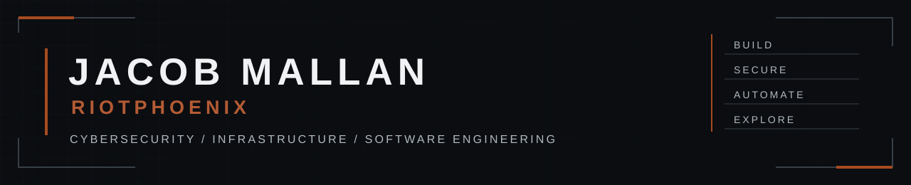

### Cybersecurity · Infrastructure · Software Engineering

**Building secure systems. Exploring what's possible.**

Cybersecurity graduate | IT Professional | Software Developer

---

## 01 / ABOUT ME

I'm **Jacob Mallan**, also known as **RiotPhoenix**.

I'm a cybersecurity graduate and IT professional with a passion for developing practical software, security platforms, AI-powered applications and infrastructure solutions.

I graduated from **Bournemouth University** with a:

**BSc (Hons) Cybersecurity with Digital Forensics**  
*Second Class Honours (Upper Division) — 2:1*

My professional experience includes enterprise IT support, Windows administration, Active Directory, Microsoft Endpoint Configuration Manager (MECM), networking, troubleshooting and IT service management.

Alongside my professional work, I develop independent software projects that explore cybersecurity, artificial intelligence, infrastructure engineering and systems development.

I use AI-assisted development tools, including Claude Code, to accelerate development while focusing on architecture, technical decisions, security, testing and maintainability.

---

## 02 / TECHNICAL CAPABILITIES

### Software Engineering

### Infrastructure & Systems

### Cybersecurity & Digital Forensics

- Network security and traffic analysis
- Digital forensics and incident investigation
- OSINT and intelligence gathering
- Security tooling and automation
- Vulnerability assessment methodologies
- Risk management and security governance
- Secure software development principles

**Tools:** Wireshark · Nmap · Volatility 3 · IntelOwl

### Enterprise IT

- Active Directory administration
- Microsoft Endpoint Configuration Manager
- Windows endpoint troubleshooting
- Remote access and connectivity
- ITIL-aligned incident management
- Technical documentation and training
- Enterprise and healthcare IT systems

---

## 03 / FEATURED PROJECTS

A selection of my independent development projects exploring security, artificial intelligence, infrastructure and software engineering.

*Detailed technical documentation and public repository links will be added as projects are prepared for publication.*

### ARGUS
**Cybersecurity & OSINT Intelligence Platform**

A modular cybersecurity and open-source intelligence platform designed to support security investigations, asset intelligence and evidence management.

**Key areas:**
- OSINT collection and processing
- Asset intelligence and relationships
- Evidence management and reporting
- Authentication and audit logging
- Event monitoring and alerting

`Python` `FastAPI` `React` `PostgreSQL` `OSINT`

---

### OLYMPUS
**Infrastructure Observability & Control Plane**

A distributed observability platform designed to monitor infrastructure nodes, collect telemetry and manage operational state.

**Key areas:**
- Linux monitoring agents
- Centralised control plane
- Historical telemetry collection
- Node management
- Authentication and credential lifecycle

`Python` `FastAPI` `Linux` `GTK` `Telemetry`

---

### HELIOS
**Modular AI Platform**

A modular AI application ecosystem exploring local language models, intelligent interfaces and integration between independent software components.

**Key areas:**
- Local LLM integration
- Modular application architecture
- Interactive React interfaces
- Backend services and APIs
- AI-assisted workflows

`Python` `FastAPI` `TypeScript` `React` `Ollama`

---

### GRID
**Personal Knowledge & Intelligence Platform**

A knowledge-management application exploring semantic search, interconnected information and local AI integration.

**Key areas:**
- Knowledge graph visualisation
- Semantic search
- Markdown knowledge management
- Plugin architecture
- AI-assisted knowledge discovery

`TypeScript` `React` `AI` `Knowledge Graphs`

---

### ATLAS OS
**Linux Infrastructure & Home Server Platform**

A Linux-based infrastructure project focused on self-hosted services, monitoring, system management and operating system customisation.

**Key areas:**
- Linux system configuration
- Containerised services
- Infrastructure monitoring
- Remote connectivity
- Security hardening

`Linux` `Fedora` `Podman` `Grafana` `Prometheus`

---

### VITAE
**Personal Life Operating System**

A modular personal management platform exploring structured information, workflow automation and integrated personal productivity.

**Key areas:**
- Modular application design
- Personal information management
- Workflow organisation
- Data architecture
- AI-assisted software development

`Software Architecture` `Application Development` `Automation`

---

### FINANCE TRACKER
**Encrypted Local-First Financial Application**

A native Linux finance application exploring secure local data storage, encryption and privacy-conscious application development.

**Key areas:**
- Encrypted local storage
- Secure key derivation
- Native desktop interfaces
- Privacy-first architecture
- Local data management

`Rust` `GTK4` `SQLCipher` `Argon2id`

---

### EVERWAKE
**High-Fantasy Game Development**

An independent fantasy game development project exploring systemic gameplay, world-building and software architecture.

**Key areas:**
- Game systems development
- World and environment design
- Gameplay architecture
- Data-driven content
- Iterative prototyping

`Game Development` `Godot` `Systems Design`

---

## 04 / EDUCATION & PROFESSIONAL DEVELOPMENT

**Bournemouth University**

BSc (Hons) Cybersecurity with Digital Forensics  
Second Class Honours (Upper Division) — 2:1

Areas of academic study included:

- Network security and penetration testing
- Digital forensic investigation
- Memory and network traffic analysis
- Cryptography and information security
- Risk management and security governance
- Software development and research

**Dissertation:**  
*Design and Development of a Modular Penetration Testing Toolkit for Small Organisations*

**Additional training:**  
NHS.net Connect Level 1 Help Desk Administration

---

## 05 / CURRENT FOCUS

I'm currently focused on:

- Developing practical cybersecurity and infrastructure tools
- Improving my software engineering and secure development practices
- Building and documenting independent technical projects
- Expanding my knowledge of Linux and infrastructure systems
- Exploring local artificial intelligence and automation
- Progressing professionally into cybersecurity

---

## 06 / DEVELOPMENT PHILOSOPHY

I approach software development with an emphasis on:

**BUILD** — Create practical solutions to meaningful problems.

**SECURE** — Consider security throughout the development lifecycle.

**AUTOMATE** — Reduce repetitive work through tooling and intelligent workflows.

**EXPLORE** — Continuously experiment with new technologies and approaches.

AI-assisted development is part of my workflow, but technical understanding, testing, validation and maintainability remain essential.

---

## 07 / CONNECT

**Jacob Mallan | RiotPhoenix**

Cybersecurity · Infrastructure · Software Engineering

---

BUILD / SECURE / AUTOMATE / EXPLORE

<!--
**RiotPhoenix/RiotPhoenix** is a ✨ _special_ ✨ repository because its `README.md` (this file) appears on your GitHub profile.

Here are some ideas to get you started:

- 🔭 I’m currently working on ...
- 🌱 I’m currently learning ...
- 👯 I’m looking to collaborate on ...
- 🤔 I’m looking for help with ...
- 💬 Ask me about ...
- 📫 How to reach me: ...
- 😄 Pronouns: ...
- ⚡ Fun fact: ...
-->
